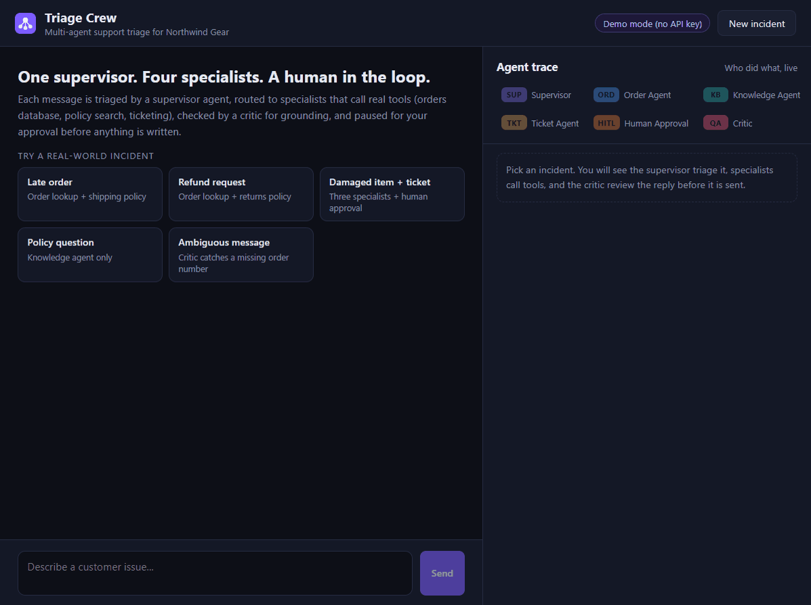
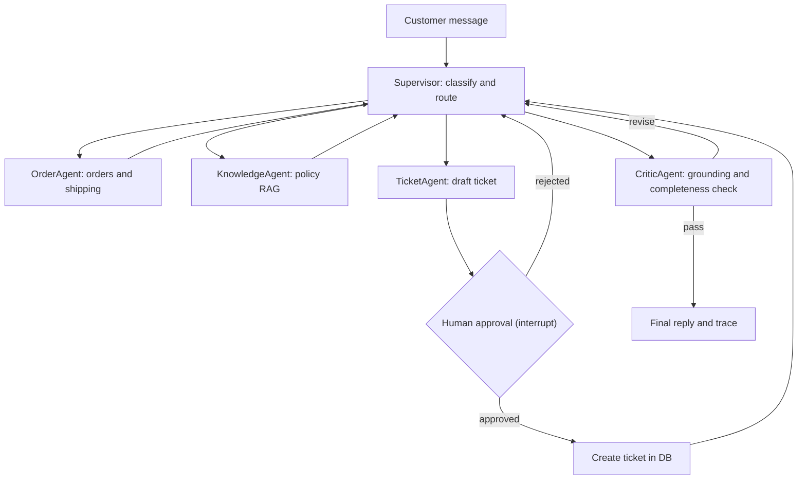

# Triage Crew

[](https://github.com/binodsapkota/triage-crew/actions/workflows/ci.yml)


**A multi-agent customer-support system: a LangGraph supervisor triages each incident, routes it to specialist
agents that call real tools, pauses for human approval before any write, and has a critic check every reply for
grounding before it is sent.**

Runs fully offline in demo mode (no API key), or on any OpenAI-compatible model, including a local Ollama model.



## What it does

A customer writes: *"Order 1047 arrived damaged, one tent pole is snapped. Please open a ticket."*

1. **Supervisor** reads the message and produces a structured triage plan: intents `damaged_item, ticket_request`,
   order `1047`, specialists `order_agent → knowledge_agent → ticket_agent`.
2. **Order Agent** queries the orders database: platinum customer, delivered two days ago, box damaged in transit.
3. **Knowledge Agent** retrieves the relevant policy sections (damage reporting, tent warranty) with BM25.
4. **Ticket Agent** drafts an `urgent` damage ticket (platinum tier plus damage), then the graph **pauses**.
5. **A human** reviews the draft in the UI, optionally edits the priority or title, and approves or rejects it.
6. **Supervisor** drafts the reply from the findings; the **Critic** verifies that every order number, ticket ID and
   dollar amount is backed by a finding, and that nothing required is missing. If not, the reply goes back for revision.

Everything streams to the UI as it happens, so you can see which agent did what, which tools it called, and how long
each step took.

## Architecture



| Layer | Stack |
|---|---|
| Orchestration | LangGraph `StateGraph`, `interrupt()` + `Command(resume=...)`, SQLite checkpointer |
| Models | Pluggable `CrewLLM` interface: deterministic `DemoLLM` or `OpenAILLM` (OpenAI, Ollama, any compatible API) |
| Tools | SQLite orders/tickets store, BM25 policy retrieval over markdown |
| API | FastAPI with server-sent events |
| UI | React 19 + TypeScript + Vite: chat, live agent trace, approval card |
| Quality | pytest (28 tests), golden-set evals, ruff, GitHub Actions |

More detail, including the state design, guardrails and event protocol: [docs/architecture.md](docs/architecture.md).

## Why multi-agent instead of one big prompt?

| Single agent | Triage Crew |
|---|---|
| One prompt decides, looks up, writes and self-checks | Each role has one job and a narrow tool set |
| Hard to tell why it answered the way it did | Every step, tool call and routing decision is in the trace |
| Write actions happen whenever the model decides | Writes are isolated behind a human approval gate |
| Hallucinated order numbers slip through | A separate critic rejects facts no specialist reported |
| Hard to evaluate | Routing is a measurable decision with a golden set |

## Quick start

### Local

```bash
# Backend (Python 3.10+)
cd backend
python -m venv .venv
.venv/Scripts/activate            # Windows. On macOS/Linux: source .venv/bin/activate
pip install -e ".[dev]"
uvicorn app.main:app --port 8000
```

```bash
# Frontend (Node 20+)
cd frontend
npm install
npm run dev                       # http://localhost:5173
```

### Docker

```bash
docker compose up --build         # UI on http://localhost:8080, API on http://localhost:8000
```

### Use a real model

Copy `.env.example` to `.env` and set:

```bash
LLM_PROVIDER=openai
OPENAI_API_KEY=sk-...
OPENAI_MODEL=gpt-4o-mini

# Or a local model through Ollama
# OPENAI_BASE_URL=http://localhost:11434/v1
# OPENAI_API_KEY=ollama
# OPENAI_MODEL=llama3.1
```

The graph, tools, guardrails and UI are identical in both modes. Only the `CrewLLM` implementation changes.

## Try these incidents

| Scenario | Message | What to watch |
|---|---|---|
| Late order | "Where is my order 1042? It was supposed to arrive last week." | Order lookup plus shipping-delay policy, with the compensation rule |
| Refund | "I want a refund for order 1045, the rain jacket doesn't fit." | Returns policy for fit and sizing |
| Damaged item | "Order 1047 arrived damaged, one tent pole is snapped. Please open a ticket." | Three specialists, then the human approval gate |
| Policy question | "What's your warranty on hiking boots?" | Supervisor skips the order lookup entirely |
| Ambiguous | "It stopped working again and honestly I'm done with this." | Critic rejects the first draft and forces a clarifying question |
| Implicit ticket | "My order 1047 arrived damaged." | Critic notices damage policy requires a ticket and adds the Ticket Agent |

## Evaluation

`backend/evals/golden.json` holds 16 labelled incidents. `python -m evals.run_evals` runs each one end to end
(auto-approving tickets) and scores:

| Metric | Demo mode |
|---|---|
| Routing accuracy (specialists that ran == expected set) | 100% |
| Grounded replies (no unsupported order numbers, ticket IDs or amounts) | 100% |
| Required facts mentioned | 100% |
| Ticket proposal accuracy | 100% |
| Avg latency per case | ~12 ms |

CI fails if routing accuracy drops below 90%. Run the same suite against a real model with
`LLM_PROVIDER=openai python -m evals.run_evals` to compare providers. While building this, the eval set caught
three routing bugs (general policy questions triggering order lookups, and a defect on an undelivered order
triggering a ticket) that the unit tests had missed.

## Design decisions

- **The LLM plans, the graph executes.** The supervisor calls the model once per turn for a structured
  `TriagePlan`, then routing between specialists is deterministic. That removes a whole class of ping-pong loops,
  keeps routing testable, and still lets the critic add a specialist when the plan missed something.
- **Human-in-the-loop with `interrupt()`.** Drafting and approving are separate nodes. On resume LangGraph re-runs
  the interrupted node from the top, so the approval node does nothing non-idempotent before `interrupt()`.
- **Generator and critic, plus a deterministic check.** The critic combines a model review with a regex grounding
  check that cannot be talked out of its verdict. A revision budget guarantees the conversation always terminates.
- **Demo mode as a first-class provider.** `DemoLLM` implements the same interface as the real model. The project
  runs in CI, in evals and for anyone who clones it, with no key and no cost.
- **Per-turn working memory.** Conversation history persists in the checkpointer; findings and trace reset each
  turn, so follow-ups ("ok, open a ticket for it") reuse the order number without inheriting stale findings.

## API

| Method | Path | Description |
|---|---|---|
| `POST` | `/api/chat` | `{message, thread_id?}`. Streams SSE events for one turn |
| `POST` | `/api/threads/{id}/resume` | `{approved, edits?, note?}`. Resumes a paused run |
| `GET` | `/api/threads/{id}` | Conversation, trace and any pending approval |
| `GET` | `/api/tickets` | Tickets created so far |
| `GET` | `/api/scenarios` | Canned incidents for the UI |
| `GET` | `/api/health` | Status and active LLM provider |

Interactive docs at http://localhost:8000/docs.

## Project structure

```
backend/
  app/
    graph/          supervisor, agents (order, knowledge, ticket + approval, critic), state, runner
    llm/            CrewLLM interface, DemoLLM, OpenAILLM
    tools/          orders, tickets, BM25 knowledge base
    data/           seed data and policy documents
    main.py         FastAPI app with SSE streaming
  tests/            unit, graph and API tests
  evals/            golden set and eval runner
frontend/           React UI: ChatPanel, AgentTrace, ApprovalCard, ScenarioPicker
docs/               architecture notes and screenshots
```

## Roadmap

- Embedding retrieval (pgvector) alongside BM25, with retrieval-quality evals
- Parallel specialist fan-out with LangGraph `Send` when steps are independent
- LangSmith or OpenTelemetry tracing export
- Role-based approvals (for example, refunds over $100 need a supervisor)

## License

MIT, see [LICENSE](LICENSE).
