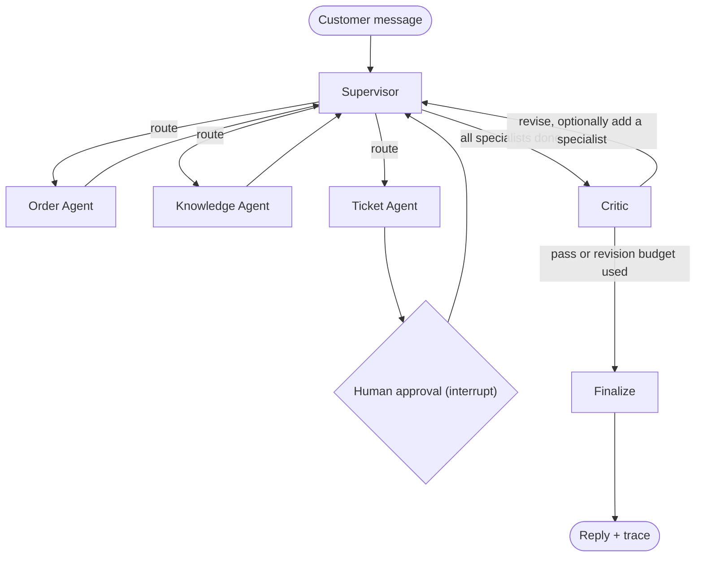

# Architecture

## Graph

| Node | Uses the LLM for | Tools |
|---|---|---|
| Supervisor | Triage plan (intents, IDs, specialists) once per turn; drafting and revising the reply | none |
| Order Agent | nothing (deterministic) | `get_order`, `list_orders` (SQLite) |
| Knowledge Agent | nothing (deterministic) | `search_policies` (BM25 over markdown sections) |
| Ticket Agent | Drafting the ticket (title, category, priority, summary) | none |
| Human Approval | nothing | `create_ticket`, only after `interrupt()` returns an approval |
| Critic | Semantic review of the draft | deterministic grounding check |

## State

`CrewState` (see `backend/app/graph/state.py`) separates conversation memory from per-turn working memory:

- `messages` uses the `add_messages` reducer and persists across turns in a thread.
- `triage`, `plan`, `completed`, `findings`, `draft_reply`, `critique`, `revisions`, `steps`, `trace` are reset by
  `new_turn()` at the start of every user message, so a follow-up never inherits stale findings.

Every node is wrapped by `traced()` (`backend/app/graph/context.py`), which streams `agent_start`, `tool_call` and
`agent_end` events through LangGraph's custom stream writer and appends a trace entry to state. The same trace is
what the UI renders live and what the API returns on `final`.

## Guardrails

| Risk | Mitigation |
|---|---|
| Runaway loops | Supervisor step budget (`MAX_SUPERVISOR_STEPS=8`), critic revision budget (`MAX_REVISIONS=1`), graph recursion limit |
| Invented facts | Critic grounding check: every order number, ticket ID and dollar amount in the reply must appear in a finding |
| Unapproved writes | Ticket creation only happens in the approval node, after `interrupt()` returns `approved: true` |
| Double writes on resume | Drafting and approving are separate nodes, because LangGraph re-runs the interrupted node from the top |
| LLM outage or bad JSON | `OpenAILLM` falls back to the deterministic rules per call and logs the failure |
| Hallucinated IDs from the LLM | Regex entity extraction is merged into the LLM triage result |

## Event protocol (SSE)

| Event | Payload |
|---|---|
| `thread` | `thread_id` |
| `agent_start` | `agent`, `label`, `started_at` |
| `tool_call` | `agent`, `tool`, `args`, `result_preview`, `duration_ms` |
| `agent_end` | `agent`, `label`, `summary`, `details`, `tools`, `duration_ms` |
| `approval_required` | `thread_id`, `kind`, `draft` |
| `final` | `reply`, `critique`, `findings`, `trace` |
| `error` / `done` | `message` / nothing |
